# UI

How Cronk's web UI looks and behaves. Read this before changing anything under `src/web/`. Vocabulary follows `GLOSSARY.md`; the UI holds no rules (ADR 0010, `docs/testing.md`), so everything here is about presentation.

The direction was chosen in #98, from prototypes of each screen. This file describes the target: the screenshots in `docs/ui/` are those prototypes, not the shipped app. The follow-up issues filed from #98 bring the code in line: #104 brought the tokens, fonts and components, and #105 to #110 rework the screens. Until those land, follow this file for new UI work and leave the old screens to their own tickets. The prototypes themselves are on the `prototype/gh-98-ui-directions` branch, outside main.

## Principles

- **What waits on the User comes first.** Blocking questions before other questions, questions before reviews, unread before read. Counts in the navigation say how much is waiting.
- **Agents and Users always look different.** A User's avatar is round and neutral. An Agent's is square and violet (`--agent`), and its name is violet wherever it appears. An Agent's Agent Session appears next to it in the mono face.
- **One chronology per thing.** A Ticket has one timeline, which also holds its Changes. There is no separate History list.
- **Kinds are labelled, not just coloured.** Every Activity, Comment and Report carries a small uppercase kind label (`PLAN`, `BLOCKING QUESTION`, `REPORT`). Colour backs the label up and never replaces it.
- **Live, in place.** Open views update without a reload and without moving what the User is reading (see [Live updates](#live-updates)).
- **Product words only.** Labels use glossary terms ("Send back", "Claim", "Delegate"), never API words ("PATCH", "statusId").

## Layout and navigation

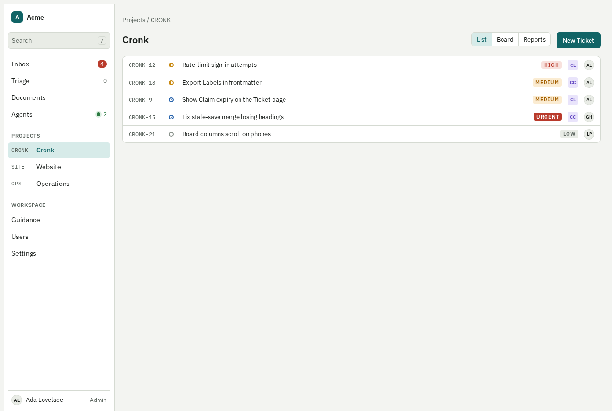

- **Frame:** a 232px left sidebar and a main column. The main column's content is at most 1120px wide, centred, with 24px vertical and 16px horizontal padding.
- **Sidebar, top to bottom:**
  - The Workspace name and mark.
  - Search, which `/` focuses.
  - Inbox, Documents and Agents, plus Triage once it exists (Phase 2). Inbox shows the number of waiting items as a red count. Agents shows the number of live Agent Sessions with a green dot.
  - **Projects**, each listed by key and name. Archived Projects are left out.
  - **Workspace**: Guidance, plus Users and Settings for Admins.
  - The signed-in User and their role, which opens the sign-out menu.
- **Active item:** `--accent-soft` background with `--accent` text. There is exactly one active item, and a Ticket or Document marks its Project or Documents.
- **Below 760px** the sidebar becomes a wrapping strip with the main links. Projects, Workspace and the User move into a menu. Two-pane screens stack.
- **Page head:** breadcrumbs (13px, muted), then a row holding the `h1`, the view switcher and the actions. The primary action comes last. Destructive actions such as Archive and Delete go in a "…" menu, never next to the primary action.
- **Project views:** List, Board and Reports are a segmented control in the page head. Statuses, Guidance and Access move into the Project's settings.
- **Routes stay as they are:** `/inbox`, `/projects/:key`, `/tickets/:key`, `/documents/:id`, `/agents`. Workspace settings gets its own route, `/settings`, instead of replacing the page.

## Design tokens

All colours are CSS custom properties on `:root` in `src/web/styles.css`. Components use only tokens, never literal colours. The dark values apply under `prefers-color-scheme: dark`.

| Token | Light | Dark | Use |
|---|---|---|---|
| `--bg` | `#f3f4f1` | `#121513` | Page ground |
| `--surface` | `#ffffff` | `#1a1e1b` | Panels, rows, cards |
| `--surface-2` | `#e9ece6` | `#232825` | Sunken: inputs, code, chips |
| `--border` | `#d5dad2` | `#2e3430` | All borders and dividers |
| `--text` | `#1b1f1c` | `#e2e6e1` | Body text |
| `--muted` | `#5c655f` | `#98a29b` | Meta, labels, timestamps |
| `--accent` | `#116466` | `#4fb2aa` | Links, primary buttons, focus ring, active nav |
| `--accent-soft` | `#d7ebe9` | `#1d3634` | Active and selected backgrounds |
| `--on-accent` | `#ffffff` | `#0c1514` | Text on `--accent` and `--danger` |
| `--agent` | `#6247c2` | `#a793f2` | Agent names, avatars, Reports, Claims |
| `--agent-soft` | `#e9e4fb` | `#2b2545` | Agent avatar and Claim backgrounds |
| `--danger` / `-soft` | `#b93a2b` / `#f8e1dd` | `#ee7d6b` / `#3d211d` | Blocking questions, errors, Urgent, destructive actions |
| `--warn` / `-soft` | `#a35f00` / `#fbecd2` | `#e3a447` / `#3a2c15` | Questions, anchored passages, stale-save warnings |
| `--ok` / `-soft` | `#2c7a42` / `#dcefe1` | `#6cc284` / `#1c3324` | Live, Findings, Completed, added diff lines |
| `--info` / `-soft` | `#2a65ad` / `#dde9f7` | `#74a8ea` / `#1b2b40` | In Review, Progress, information banners |

The Status Categories use their own dot colours: Backlog is a dashed muted ring, Unstarted a muted ring, Started a half-filled `--warn` dot, In Review a ringed `--info` dot, Completed a filled `--ok` dot, and Canceled a `--danger` dot with a stroke. A Status shows its dot and its name. Dense rows and board columns may show the dot alone, with the name in its tooltip and accessible label.

| Tokens | Values |
|---|---|
| Spacing | 4, 8, 12, 16, 24, 32 px. Lay groups out with `gap`, not margins. |
| Radius | 4px for controls and chips inside text, 6px for buttons and inputs, 8px for panels and cards, 999px for pills |
| Borders | 1px `--border`. A coloured 3px left border marks a selected or blocking list item only. |
| Shadow | Popovers and menus only |

| Light | Dark |
|---|---|
| 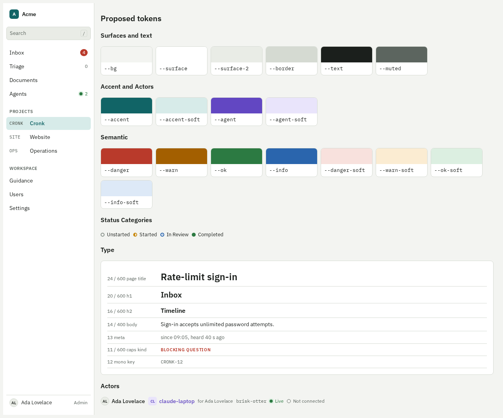 | 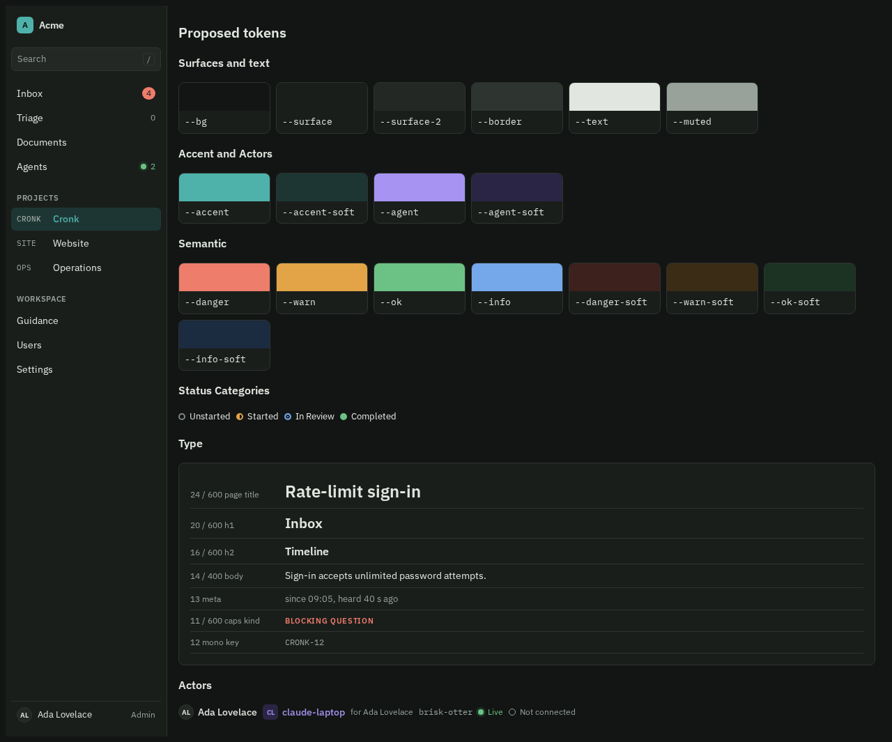 |

## Typography

- **Faces:** IBM Plex Sans for UI and prose, and IBM Plex Mono for Ticket keys, Agent Sessions, code and Markdown sources. They are bundled from npm (`@fontsource/ibm-plex-sans`, `@fontsource/ibm-plex-mono`), imported in `src/web/main.tsx` and served by Cronk itself. Never load fonts from a CDN, since installations may be offline. The fallbacks are `system-ui` and `ui-monospace`.
- **Scale:** 24/600 (Ticket and Document titles), 20/600 (`h1`), 16/600 (`h2`), 14/600 (`h3`), 14/400 (body), 13 (meta and controls), 12 (small meta, chips, keys), and 11/600 uppercase with 0.06em letter-spacing (kind labels and nav group labels).
- **Line height:** 1.5 for UI and 1.65 for Document bodies. Document text is 15px with a 720px measure.

## Component conventions

The app keeps its own small component set in `src/web/components/`, styled with the tokens in plain CSS. Accessibility-heavy primitives come from Radix UI's headless packages (`@radix-ui/react-popover`, `-dropdown-menu`, `-dialog`, `-tabs`), each wrapped once in `components/overlays.tsx` (`Popover`, `Menu`, `Dialog` and `ConfirmDialog`, `Tabs`) and styled by our classes. Cronk uses no styled component library and no Tailwind. A new component goes in that set before a second screen copies it.

- **Actor** (`<Actor>`): avatar plus name. A User is round. An Agent is square, violet, and followed by "for <Owner>" where the Owner isn't obvious. Never write "Ada (session d152, for Ada)" as prose.
- **Agent Session:** shown in the mono face as a readable two-word name derived from its id (`brisk-otter`), with the full id in the tooltip. One helper, `sessionName` in `src/web/components/actor.tsx`, computes it everywhere, and `<SessionName>` renders it.
- **Status** (`<StatusPill>`): dot and name. **Priority** (`<PriorityTag>`): a small uppercase tag. Urgent is filled `--danger`, High is `--danger` on `--danger-soft`, Medium is `--warn` on `--warn-soft`, Low is muted, and None shows nothing.
- **Label** (`<Chip>`): a neutral chip on `--surface-2`. Markers such as "Private" and "Current" use the same chip. A state marker takes a tone: `ok` ("Answered") is filled `--ok-soft`, and `warn` or `danger` ("Waiting for an answer" on a question or blocking question) is an outlined pill in that colour.
- **Kind label** (`<KindLabel>`): 11px uppercase, coloured by kind. Plan is muted, Progress `--info`, Finding `--ok`, Question `--warn`, Blocking question and Error `--danger`, Report `--agent`, and Comment `--accent`.
- **Buttons** (`<Button variant>`, or `buttonClass` for a link or file picker that looks like one):
  - Primary is filled `--accent`, one per form or action bar. It comes first in forms and action bars, and last in the page head.
  - Secondary is `--surface` with a border.
  - Ghost is text in `--accent`, for Reply, Rename and the like.
  - Danger is filled `--danger`, and only inside a confirming dialog.
  - A disabled button keeps its colours at 50% opacity with a `not-allowed` cursor.
  - Buttons size to their label and are never full width outside sign-in forms.
- **Forms:** the label sits above the field, in 12px `--muted`. Inputs have a `--surface` background and a 1px border, and show the `--accent` focus ring. Markdown inputs use the mono face. Each error sits under its form in `--danger` with `role="alert"`. A settings page, such as `/settings`, stays open after saving and says "Saved." beside its buttons (`role="status"`).
- **Pickers** (`<FieldPicker>` in `components/picker.tsx`): Ticket fields are edited in place. Clicking the value opens a Radix popover list with type-to-filter; once something is typed, Enter picks the first match, and a picker that takes new values (Labels) offers the typed text. Bare `<select>` rows are not used for this.
- **Times** (`<RelativeTime>`):
  - Relative under an hour ("12 min ago").
  - Then clock time for today ("10:18") and "yesterday".
  - Then day and time ("14 Nov 09:52"), with the year only when it differs from the current one.
  - The exact time is always in `title`.
  - A timeline shows clock times (`<RelativeTime clock>`) with a separator for each day ("Today", "Yesterday", "14 Nov").
- **Empty states:** a short heading saying what will appear and one line saying how it gets there ("Agents write a Report when they hand work over").
- **Live indicator** (`<LiveIndicator>`): a green dot with "Live" on views that are streaming. It turns into a muted "Reconnecting…" while the stream is away.

## Screens

### Project

The Project page is shown in `docs/ui/frame.png`.

- **Page head:** the title, a List / Board / Reports segmented control, a "…" menu, and New Ticket as the only primary action, last. The "…" menu holds Documents (the Project's page tree), and for those with Write access Project settings and Archive Project (Restore Project once archived), which asks for confirmation.
- **Project settings** (`?view=settings`): one section each for Access (Admins), Agent Access, Statuses and Guidance. The old addresses `?view=statuses` and `?view=guidance` open it at that section.
- **List rows:** Status dot, key, title, Labels, Priority tag, and the Delegate's and Assignee's avatars, each named in its tooltip ("Delegate: claude-laptop").
- **Board:** open columns share the main column's width. Columns in the Completed and Canceled Status Categories start collapsed to their dot and count, and clicking one opens it until the User leaves the page; nothing is stored. So a 1280px screen shows every Status without sideways scrolling. Cards show the key, Priority, title, Labels and the avatars.

### Inbox

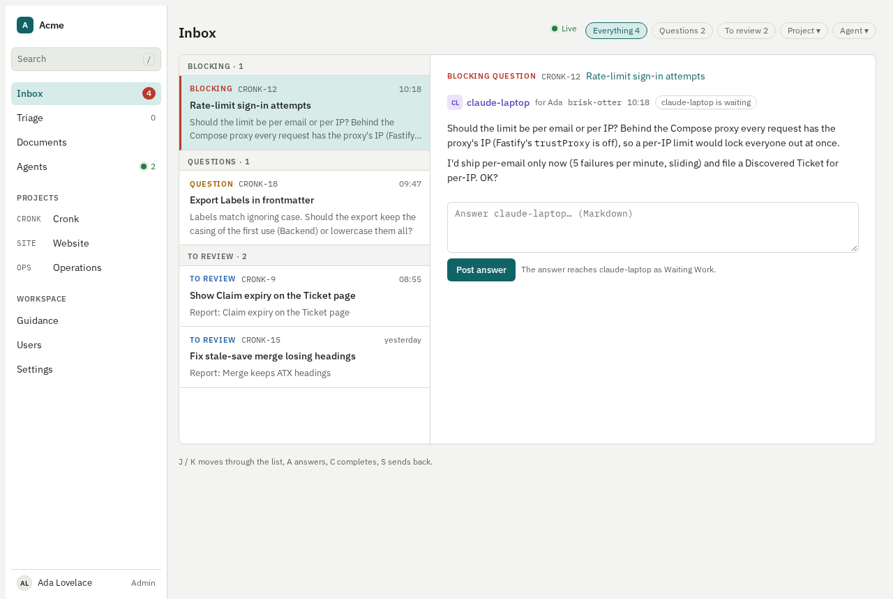

- **Layout:** a split view. The list on the left (360px) is grouped **Blocking**, **Questions** and **To review**, each with a count. The selected item opens on the right.
- **List items:** each shows its kind label, Ticket key, time, Ticket title and a two-line snippet of the question, or the Report's title. A blocking item has a `--danger` left border.
- **Detail pane:**
  - **A question** shows the Agent, its Agent Session and the full question, with an answer box underneath. "Post answer" says the answer reaches the Agent as Waiting Work.
  - **A review** shows the Ticket's Status and the full Report rendered inline. The action bar holds **Complete** (primary), **Send back…** (opens a required "What is left to do" box) and a link to the Ticket.
- **Filters:** chips for kind, Project and Agent, kept in the address as today.
- **Keyboard:** J and K move through the list, A focuses the answer box, C completes and S sends back.
- **Acting on an item:** the next item is selected. It never jumps to the top of the list.
- **Phone:** the list and the detail stack, and selecting an item opens the detail full width.

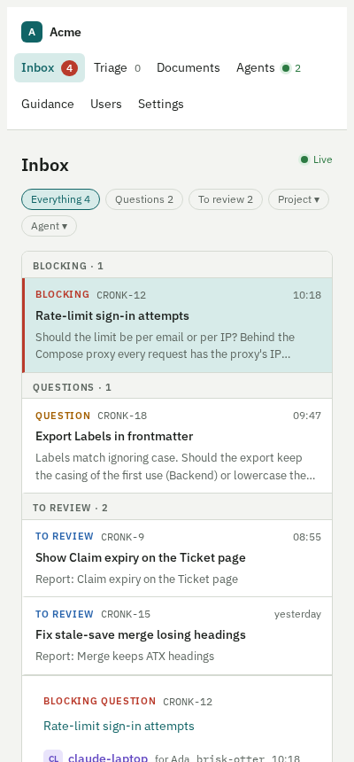

### Ticket

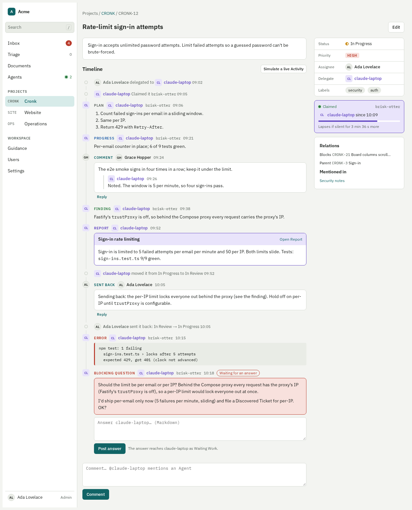

- **Main column:** the title, the description, then one **timeline** and the Comment box at the end.
- **Side panel (280px, sticky):**
  - Status, Priority, Assignee, Delegate and Labels, each edited in place.
  - The **Claim card**, in `--agent-soft`. It shows the Agent, its Agent Session, the claim time and a meter counting down until the Claim lapses if the Agent Session stays silent. The meter runs from when the page last loaded the Claim, since the API gives the lapse time but not the threshold. It is hidden when the Ticket is not Claimed.
  - Parent, Sub-Tickets, Relations and Mentioned in.
- **Below 900px** the side panel moves above the timeline.
- **Timeline entries**, oldest first, each with an avatar in the gutter:
  - **Activity:** a kind label, the Agent and its Agent Session, the time, and the body as rendered Markdown with no card around it. A question's body sits in a `--warn-soft` box, or `--danger-soft` when blocking, with its answer box. Errors are mono on `--surface-2` with a `--danger` left border.
  - **Comment:** the body in a bordered bubble, with replies indented under it. The Comment of a Send back is labelled `SENT BACK`.
  - **Report:** a card with an `--agent` border, its title and an "Open Report" link. The body is shown at body size, and its headings are scaled down to 14px.
  - **Change** (today's History): a single muted line with a small ring in the gutter, such as "claude-laptop moved it from In Progress to In Review".
- **Replying:** only Comments and questions offer a Reply button. Plan, Progress, Finding and Error don't, but a Comment can still quote them.

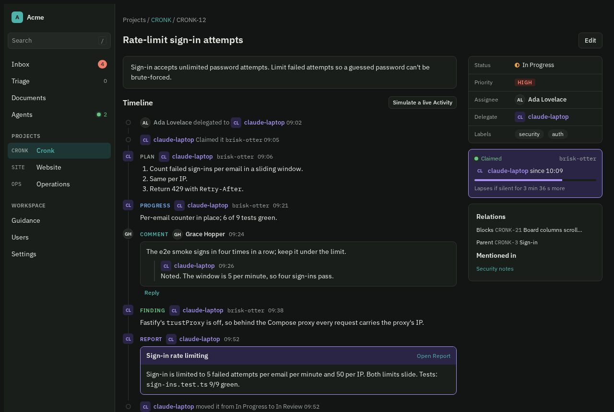

### Document

| Read | Edit | Merge |
|---|---|---|
| 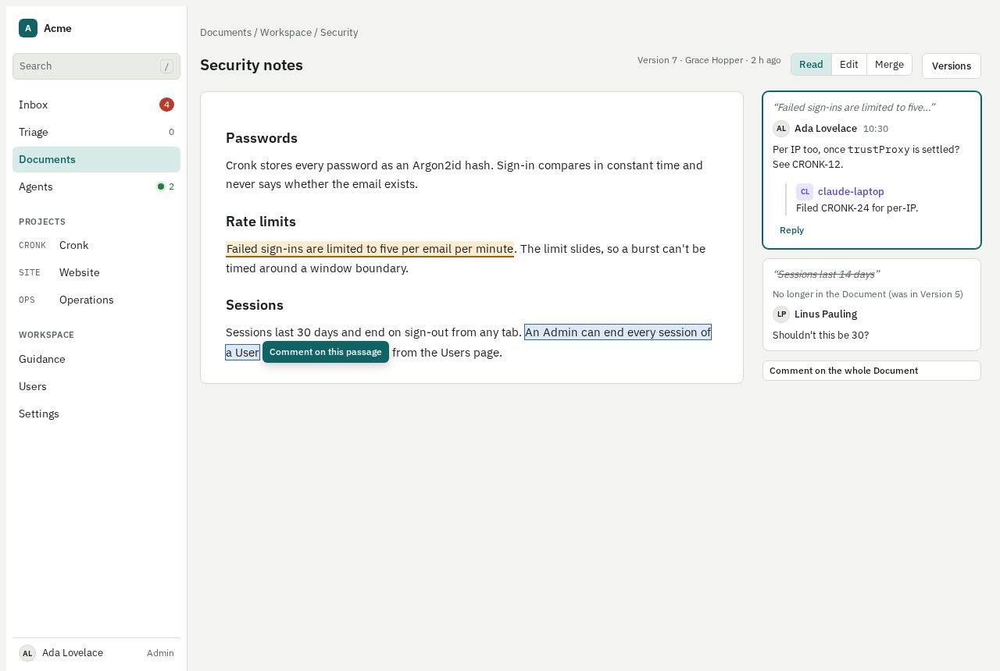 | 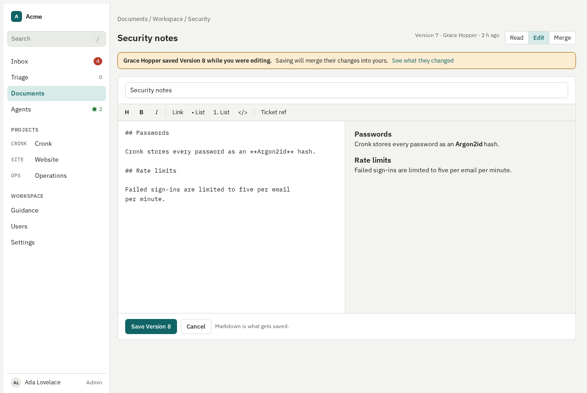 | 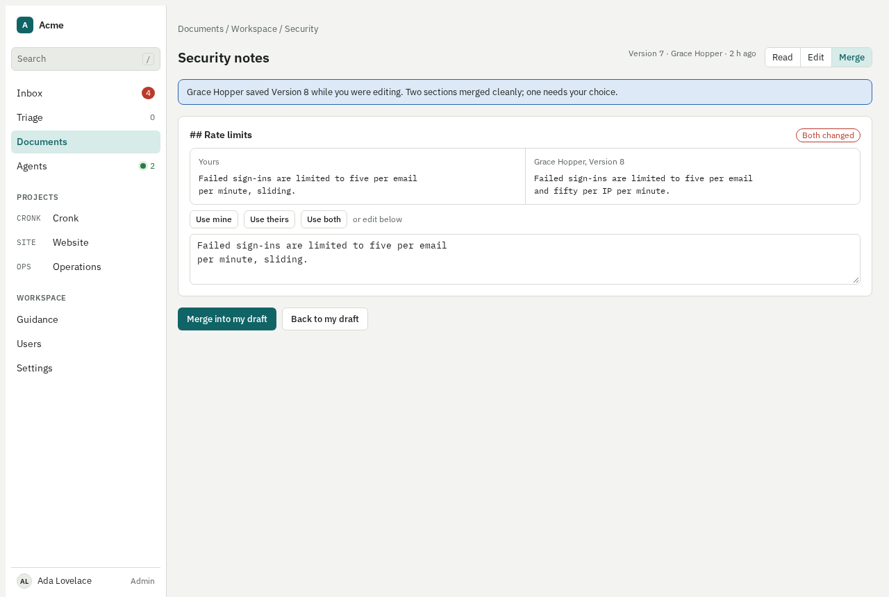 |

- **Read:**
  - The Document's body sits in a panel with a 720px measure.
  - Comments run down a 280px right margin, each card aligned with its passage. Anchored passages are highlighted in `--warn-soft` with a `--warn` underline. Hovering or focusing either the passage or the card highlights both in `--accent-soft`.
  - Selecting text in the body shows a "Comment on this passage" popover, which prefills the anchor (#97).
  - A detached anchor shows its passage struck through, with "No longer in the Document (was in Version n)".
  - "Comment on the whole Document" sits at the end of the margin.
  - Below 900px the margin moves under the body.
- **Edit:**
  - The title field, then a toolbar: heading, bold, italic, link, bullet and numbered lists, code and Ticket reference.
  - Below it the Markdown source (mono) sits beside a live preview, rendered through the same pipeline as the read view (#97). They stack on phones.
  - The save button names the Version it will create.
  - When someone saves while the User edits, a `--warn` banner says who and offers their changes. The page doesn't wait for the save to be refused (#94).
- **Merge:**
  - An `--info` banner, not an error, says who saved which Version and how many sections need a choice.
  - Each conflicting section is a panel with **Yours** and **theirs** side by side, then Use mine, Use theirs and Use both, then an editable result.
  - Sections that merged cleanly show as a folded diff. Only the "Both changed" chip is `--danger`.

### Agents

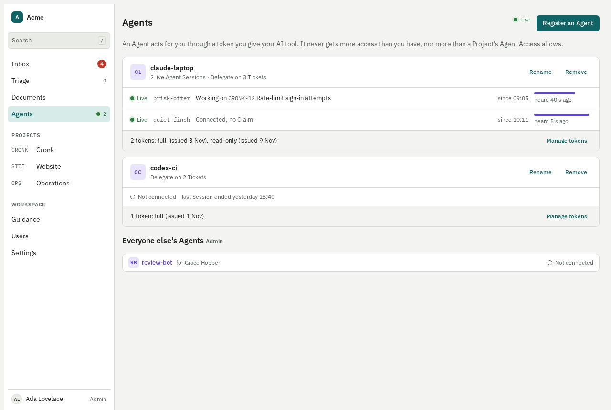

- **Order:** "Register an Agent" is a button in the page head that opens a dialog. It isn't a form at the top of the page.
- **Cards:** one per Agent.
  - **Head:** an avatar, the name, and a summary ("2 live Agent Sessions · Delegate on 3 Tickets"), with Rename and Remove.
  - **One row per live Agent Session:** Live, the Agent Session's name, the Ticket it has Claimed ("Working on CRONK-12 …") or "Connected, no Claim", when it connected, and a meter for the time until it would fall silent.
  - "Not connected" with when its last Agent Session ended, when none is live.
  - **Footer:** the Agent's API tokens in one line ("2 tokens: full, read-only") with "Manage tokens", which opens a dialog that issues and revokes them. A new token's secret is shown once in that dialog, with a copy button.
- **Admins** also see "Everyone else's Agents" below, as rows of Agent, Owner and liveness, read-only.

## Live updates

Server-sent events (ADR 0012) keep open views current, and #94 adds topics for Ticket fields, boards and Documents. Every screen treats them the same way:

- New entries appear in place (timeline entries at the end, Inbox items in their group), with a short `--accent` ring that fades over about 2s. The page never scrolls on its own unless the User is already at the end.
- A changed field updates where it is shown, such as the side panel, a Ticket on the board or the Claim card. Nothing reloads the whole page or flashes empty while reloading.
- An item the User is acting on is never removed under them. If it is resolved elsewhere, it stays visible as "Resolved elsewhere", with its actions disabled and a link to its Ticket, until the User moves on. It doesn't name who resolved it: the Inbox lists only open items, and the Ticket shows who (#106).
- Every streaming view shows the Live indicator, and reconnects reload its lists (as `watchInbox` and `watchTicket` already do).

## Changing this document

A change to a token, a component convention or a screen's layout updates this file in the same pull request, and its screenshot when the screen's shape changes.
